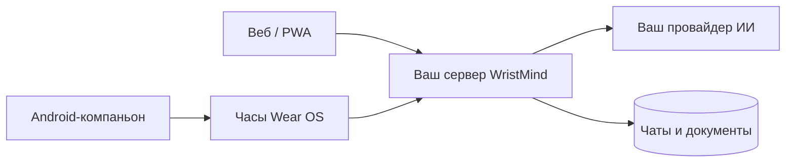

<div align="center">
  
  <h1>WristMind SelfHost</h1>
  <p>Ваш ИИ-помощник. Ваш сервер. Общие чаты в браузере и на часах.</p>
  <p>
    
    
    
  </p>
  <p><a href="SETUP.md">Начать установку</a> · <a href="docs/COMPANION_SETUP.md">Подключить часы</a> · <a href="docs/SELF_HOSTING_RELEASES.md">Обновления и резервные копии</a></p>
</div>

---

Веб-чат и приложение Wear OS с общей историей разговоров. Панель, API, обработка документов и база работают на **одном вашем сервере**. Подключите свой сервис ИИ и его ключ; запросы оплачиваются по тарифу выбранного провайдера.

Эта версия готовится к первому публичному выпуску. Локальные проверки выполнены, но финальная установка на чистом сервере и проверка настоящих часов ещё ожидаются. Доступен предварительный Android-компаньон; готовые серверные пакеты ещё не опубликованы.

## Скачать

**[Скачать Android-компаньон 0.2.0](https://github.com/IvanSemenkin/wristmind-selfhost/releases/download/android-v0.2.0-preview.1/wristmind-companion-0.2.0-preview.1.apk)** · [Релиз и SHA256](https://github.com/IvanSemenkin/wristmind-selfhost/releases/tag/android-v0.2.0-preview.1)

Для телефона с Android 11+. Компаньон сам устанавливает приложение на совместимые часы Wear OS. APK подписан постоянным сертификатом для будущих обновлений. Это предварительная версия: реальные сервер и часы ещё проходят приёмку.

## Возможности

| Возможность | Как работает |
| --- | --- |
| Общая история | Чаты синхронизируются между вебом и Wear OS |
| Веб-чат | Потоковые ответы, Markdown, KaTeX, графики и информационные блоки |
| Свои провайдеры | Подключения с собственными ключами и список выбранных моделей |
| Документы | Загрузка источников, локальный OCR и ответы по вашей базе знаний |
| Поиск | Автоматический веб-поиск и необязательный локальный поиск по смыслу |
| Часы | Установка и обновление Wear APK через Android-компаньон |
| Обслуживание | Терминальное меню, резервные копии, обновление и откат |



## 1. Установить сервер

Для автоматической установки используйте Ubuntu 22.04/24.04/26.04 или Debian 12/13 (amd64/arm64), Bash, curl и доступ в интернет. Python, Docker, Compose и системные утилиты подготавливаются автоматически; при необходимости запрашивается sudo. Скрипт проверит процессор, память, диск и свободный порт. Оценка ресурсов не гарантирует конкретную скорость.

Запустите одну команду на сервере:

```bash
bash <(curl -fsSL https://raw.githubusercontent.com/IvanSemenkin/wristmind-selfhost/main/install.sh)
```

Откроется меню: выберите каталог, проверьте требования и нажмите «Установить / продолжить установку». Через это же меню доступны HTTPS, состояние, обновления и резервные копии. Повторный запуск команды открывает меню для существующей установки; данные не удаляются. Для первого входа после установки:

**В меню выберите:** 6 «Ссылка первого входа».

Этот пункт выдаст одноразовую ссылку первого входа. Не пересылайте её другим людям. По умолчанию HTTP слушает только этот сервер; для временного доступа с компьютера используйте SSH-forward:

Для локального доступа с компьютера можно использовать защищённый SSH-туннель средствами своего SSH-клиента. Для обычного доступа с телефона и часов выберите пункт 4 меню и настройте HTTPS.

Затем откройте адрес из ссылки через `http://127.0.0.1:8080`. Для телефона и часов настройте HTTPS: пункт 4 «Домен / HTTPS / туннель». Домен необязателен: поддерживается туннель за NAT. [Установка и восстановление](docs/SELF_HOSTING_INSTALL.md), [HTTPS и туннель](docs/SELF_HOSTING_ACCESS.md).

## 2. Подключить помощника

Создайте владельца, выберите провайдера, введите **его** API-ключ и выберите модель для ответов. Проверка модели делает небольшой платный запрос. Ключ не относится к локальному поиску и не выдаётся WristMind.

После настройки откройте `/main` для панели или `/talk` для интерфейса только с чатами. Веб-приложение можно добавить на главный экран средствами браузера.

- Чтение текстовых документов, локальный OCR и поиск по словам работают на сервере без дополнительной модели.
- Веб-поиск настраивается установщиком автоматически через SearXNG; результаты зависят от доступности внешних поисковых систем.
- Поиск по смыслу необязателен: пункт 7 установит локальную модель, проверит её и назначит для документов. API-ключ не нужен.

**В меню выберите:** 7 «Локальный поиск по смыслу».

Понимание изображений и серверное распознавание голоса подключаются через внешних провайдеров. Локальный установщик не устанавливает vision, чатовые или голосовые модели. Без серверного распознавания часы используют встроенную диктовку. [Возможности и требования](docs/SELF_HOSTING_CAPABILITIES.md), [локальный поиск](docs/LOCAL_MODELS.md).

## 3. Подключить часы

Установите [Android-компаньон](https://github.com/IvanSemenkin/wristmind-selfhost/releases/download/android-v0.2.0-preview.1/wristmind-companion-0.2.0-preview.1.apk) из [предварительного релиза](https://github.com/IvanSemenkin/wristmind-selfhost/releases/tag/android-v0.2.0-preview.1). APK часов уже встроен в компаньон — отдельно скачивать его не нужно. В панели создайте код подключения; в компаньоне укажите HTTPS-адрес своего сервера и этот код. Мастер поможет включить беспроводную отладку Wear OS, сопрячь телефон, установить встроенный APK и передать настройки.

Код панели и код ADB-сопряжения — разные коды. После установки выключите отладку. [Пошаговая инструкция и обновления часов](docs/COMPANION_SETUP.md).

## 4. Обслуживание

Обновления сервера выполняются **только из терминала**. Перед обновлением создаётся резервная копия; пользовательские данные сохраняются. Компаньон и часы обновляются отдельно APK с тем же сертификатом подписи.

```bash
bash <(curl -fsSL https://raw.githubusercontent.com/IvanSemenkin/wristmind-selfhost/main/install.sh)
```

[Релизы, обновление, резервные копии и откат](docs/SELF_HOSTING_RELEASES.md). Не удаляйте Docker volumes и не публикуйте `.env`, бэкапы, ключи подписи или одноразовые ссылки.

## Для разработчика

Рабочие модули: `server/`, `web/`, `selfhost/`, `android/core`, `android/phone`, `android/wear`. Исторические Zepp/Poco-модули не входят в пользовательский пакет. Android собирается JDK 21; bytecode target 17. Серверный runtime описан в [SELF_HOSTING_RUNTIME.md](docs/SELF_HOSTING_RUNTIME.md).

## Документация

| Руководство | Что внутри |
| --- | --- |
| [SETUP.md](SETUP.md) | Пошаговый старт для новой установки |
| [Установка сервера](docs/SELF_HOSTING_INSTALL.md) | Требования, параметры и восстановление незавершённой установки |
| [Внешний доступ](docs/SELF_HOSTING_ACCESS.md) | HTTPS, домен и туннель за NAT |
| [Часы и компаньон](docs/COMPANION_SETUP.md) | Сопряжение, установка и обновление Wear APK |
| [Возможности](docs/SELF_HOSTING_CAPABILITIES.md) | Назначения моделей и требования к серверу |
| [Локальный поиск](docs/LOCAL_MODELS.md) | Автоматическая установка embeddings без API-ключа |
| [Обслуживание](docs/SELF_HOSTING_RELEASES.md) | Релизы, резервные копии и откат |
| [Приёмка выпуска](docs/PUBLIC_RELEASE_CHECKLIST.md) | Что уже проверено локально и что осталось проверить |

Перед первым стабильным выпуском нужны реальная серверная приёмка, проверка часов, выбор лицензии и постоянная подпись APK. Для подготовки исходников есть `selfhost/public_source.py`: он не переносит историю рабочего проекта, приватные настройки и пользовательские данные. Автоматический сканер не заменяет ручной аудит.
